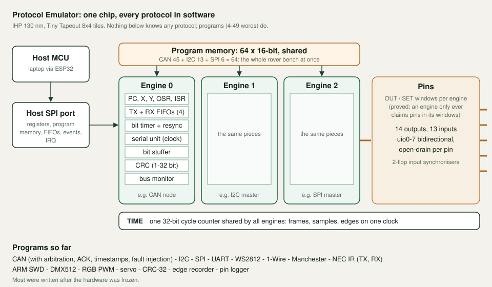

   

# Protocol Emulator

A Tiny Tapeout chip (IHP 130 nm, 8x4 tiles) with three programmable timing engines that run wire protocols as software: CAN, I2C, SPI, UART, and protocols it was not designed for. Built for Jane Street's Protocol Emulator challenge, and for the NUS Mars Rovers drive-train power bench: one chip that commands the CubeMars motors over CAN while it reads the power monitor (I2C) and a fast ADC (SPI), all stamped on one clock.

| At a glance | |
|---|---|
| Engines | 3, sharing a 64 x 16-bit program memory; each with TX/RX FIFOs, bit timer, stuffer, CRC unit, serial shifter |
| Protocols written for it | 20 programs, most written after the hardware was finished (table below) |
| Clock | rated 40 MHz, signed off in the worst corner (1.08 V, 125 C); the layout has slack to 57 MHz there, 90 MHz typical |
| Built with | [Hardcaml](hardcaml/) (Jane Street's OCaml hardware library): the taped-out Verilog is generated from it and formally proven equal to a hand-written Verilog reference |
| Verified by | clock-by-clock comparison with a Python golden model, protocol tests against device models, formal proofs, gate-level simulation ([docs/VERIFICATION.md](docs/VERIFICATION.md)) |
| Write-up | [docs/WRITEUP.md](docs/WRITEUP.md) |

| Where | |
|---|---|
| Architecture, ISA, registers | [docs/ISA.md](docs/ISA.md) |
| Datasheet page | [docs/info.md](docs/info.md) |
| Protocol programs | [sw/programs/](sw/programs/) (`can.pio`, `i2c_master.pio`, `spi_master.pio`, `uart_tx.pio`, `uart_rx.pio`) |
| Assembler | `python sw/pemu/asm.py sw/programs/can.pio` |
| Golden model | [sw/pemu/model.py](sw/pemu/model.py) |
| Host tools | [sw/pemu/host.py](sw/pemu/host.py), [sw/pemu/can.py](sw/pemu/can.py), [sw/pe.py](sw/pe.py) |
| Tests | [test/](test/) (cocotb), [sw/test_tools.py](sw/test_tools.py) (pytest) |
| Hardcaml description + equivalence proofs | [hardcaml/](hardcaml/), [formal/](formal/) |
| LED-board prototype (FPGA plays the chip) | [fpga/](fpga/), [esp32/pe_bridge/](esp32/pe_bridge/) |



## What one engine can be

The engines know nothing about any protocol. They offer generic pieces (shift registers, FIFOs, a bit timer that locks onto bus edges, two pacing points per bit, a bit stuffer, a CRC unit, a clocked serial shifter, bus monitoring), and the protocol lives in a few words of program:

| Program | Words | What it does |
|---|---|---|
| `can.pio` | 45 | A complete CAN 2.0A/B node: receives and ACKs every frame (11- and 29-bit IDs), sends queued frames with arbitration and an ACK check, timestamps every start of frame |
| `i2c_master.pio` | 13 | I2C master: START / repeated START / STOP, ACK/NACK, clock stretching |
| `spi_master.pio` | 6 | SPI master, any mode, full duplex |
| `uart_tx.pio`, `uart_rx.pio` | 6, 10 | UART 8N1, receiver locked to every edge, framing errors flagged |
| `ws2812.pio` | 6 | WS2812 / NeoPixel LED strips (pulse-width coded bits) |
| `onewire.pio` | 21 | 1-Wire master: reset/presence, read and write slots (DS18B20 temperature sensor) |
| `manchester_tx.pio` / `manchester_rx.pio` | 12 / 12 | Manchester line coding; the receiver recovers the clock from the data |
| `dmx_tx.pio` | 15 | DMX512 stage-lighting transmitter |
| `ir_nec_rx.pio` | 14 | NEC IR remote receiver (bit-timer based) |
| `rgb_pwm.pio` | 18 | 3-channel PWM (RGB strip) from one engine |
| `spi_auto.pio` | 4 | compact SPI master (autopull/autopush) |
| `crc32.pio` | 8 | CRC-32 (Ethernet / zip / PNG) with the CRC unit |
| `swd.pio` | 28 | ARM Serial Wire Debug host (reads a Cortex-M's debug port) |
| `ir_tx.pio` | 7 | IR remote, 38 kHz carrier, any mark/space protocol (NEC encoder in `sw/pemu/ir.py`) |
| `can_fault.pio` | 49 | CAN node with fault injection (bad CRC on demand): `sw/motor_emu.py` makes the chip an AK motor for the rover's controller |
| `edge_capture.pio` / `pin_logger.pio` | 6 / 8 | edge timestamps for the protocol detective (`pe.py detect`); pin-change log for `pe.py lockstep` |
| `servo.pio` | 8 | servo / ESC pulses (the tutorial's example) |
| `uart_autobaud.pio` | 37 | UART receiver that finds the baud rate itself: the engine times a 'U' and retimes its own bit timer (`CTL BAUD`) |

The bench's three programs together fill the 64-word program memory exactly, and run at the same time.

**Try it in a browser:** `docs/playground.html` runs the golden model (via Pyodide) with seven example protocols and a live waveform; edit a program and run it, nothing to install (`python tools/build_playground.py` rebuilds it from the current sources).

**Write your own:** [docs/TUTORIAL.md](docs/TUTORIAL.md) adds a protocol from scratch in about 20 minutes, and `python sw/pesim.py PROGRAM.pio --cfg ... --vcd out.vcd` runs any program on the golden model with a waveform out (no hardware, no Verilog simulator).

## Run the tests

```
cd test && make                    # 35 cocotb tests: RTL vs golden model, protocols vs device models
cd test && make HARDCAML=chip      # the same tests on the chip generated from Hardcaml
python -m pytest sw/test_tools.py  # assembler, CAN helpers, pe.py demos on a virtual board
python sw/pe.py --sim can          # any pe.py demo, on the golden model (no hardware)
```

## On the LED board

Double-click `gate1_run.bat`: it flashes the ESP32 (which loads the chip into the FPGA), then runs the demos through `sw/pe.py`: chip ID, an engine blinking LED0, UART between two engines, and CAN between two engines (fit a jumper between J3 pins 9 and 10).
