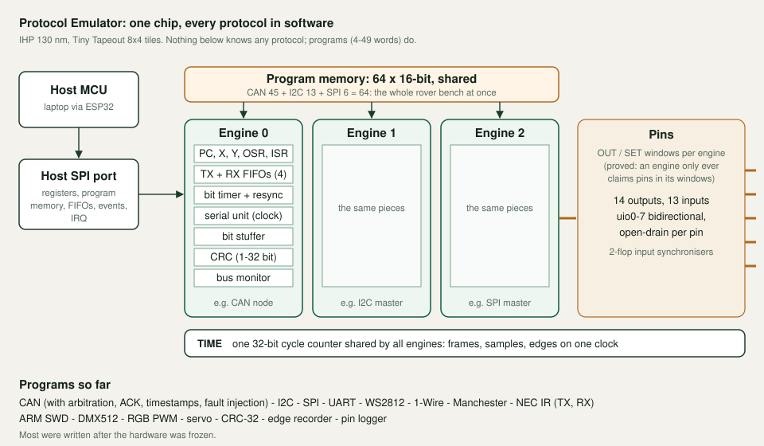

# Protocol Emulator: write-up (draft)

*Rajat Gupta, NUS Electrical Engineering. Tiny Tapeout, IHP 130 nm, 8x4 tiles.*

> Status of this draft: architecture, verification and protocol sections are complete. Sections marked **[after the bench]** get real measurements from the rover drive-train bench (Gate 5), and the video script is at the end.

## 1. The idea in one paragraph

Every wire protocol is a few things: bits that leave and arrive at the right moments, shift registers that turn words into bits, and a little framing (start bits, stuffing, CRCs, acknowledgements). This chip has three small engines that do exactly those things and nothing protocol-specific. The protocol lives in a program of 5 to 45 sixteen-bit words. One engine is a full CAN 2.0 node (receive, acknowledge, transmit with arbitration, timestamps); the other two are an I2C master and an SPI master; all three fit in the 64-word program memory together and run at once. That is the drive-train power bench of the NUS Mars Rovers team: one chip commanding a CubeMars motor while it measures the power it draws, on one clock.

## 2. Architecture



```
            host MCU (RP2350 / ESP32)
                 |  SPI: registers, program memory, FIFOs
        +--------+---------------------------------------------+
        |   program memory 64 x 16 (shared)       TIME (32-bit)|
        |      |            |            |                     |
        |  engine 0     engine 1     engine 2      4 events    |
        |  X Y OSR ISR  ...          ...                       |
        |  TX/RX FIFO   bit timer    serial unit               |
        |  CRC, stuffer, monitor                               |
        +------+----------------+-------------------+----------+
               | 14 outputs      | 13 inputs         | open-drain
               +-----------------+-------------------+
                  uio[7:0] (bidirectional), uo_out[7:2], ui_in[7:3]
```

Details: [ISA.md](ISA.md). In short, an engine executes one instruction per tick. Eight instructions (JMP, WAIT, IN, OUT, PUSH/PULL, MOV, SET, CTL) are close to the RP2040's PIO, so the programming model is familiar; the differences are the pieces below, each added because several protocols need it.

## 3. The generic pieces, and who needs them

| Piece | What it does | Used by |
|---|---|---|
| Bit timer with edge resync | Counts bit periods; any bus edge restarts the count, so the timer follows the transmitter's clock | UART RX, CAN, (Manchester, DMX, LIN) |
| Two pacing points | A paced pin write waits for the next bit start, any other paced instruction for the sample point. One engine can drive a bit and read it back in the same bit time | CAN TX + arbitration, UART TX/RX, 1-Wire-style slots |
| Serial unit | `IN/OUT PINS, n` move n bits through one pin, one per tick, with an optional generated clock (CPOL/CPHA), duplex sampling and clock stretching | SPI (all modes), I2C, CAN fields, UART bytes |
| Bit stuffer | Both-levels (CAN) or ones (USB) stuffing on transmit and destuffing on receive, including a stuff bit right after a field | CAN, USB, HDLC-style |
| CRC unit | Any width 1-32, any polynomial, fed from sent or received data bits | CAN (CRC-15), 1-Wire / SMBus (CRC-8), USB (5/16), Modbus |
| Monitor mode | "Does the bus equal my last bit?" as a jump condition; no resync on the engine's own dominant bits | CAN arbitration and bit errors, I2C multi-master |
| Shared TIME + `IN TIME` | Every engine can stamp events with the same 32-bit cycle counter | Timestamped CAN frames; correlating buses |
| `OUT PC` | A computed jump: the host's data word names the routine to run | I2C steps (start/byte/stop), 1-Wire steps |

## 4. What one engine can be

| Program | Words | |
|---|---|---|
| `can.pio` | 45 | CAN 2.0A/B node: RX + ACK every good frame, TX with arbitration and ACK check, SOF timestamps |
| `can_fault.pio` | 49 | the CAN node plus fault injection (a frame sent with its CRC inverted), for device emulation |
| `i2c_master.pio` | 13 | START / repeated START / STOP, ACK/NACK, clock stretching |
| `spi_master.pio` | 6 | Any mode, full duplex, any length |
| `uart_tx.pio` / `uart_rx.pio` | 6 / 10 | 8N1, edge-locked receiver, framing errors |
| `ws2812.pio` | 6 | NeoPixel LED strips |
| `onewire.pio` | 21 | 1-Wire master (DS18B20) |
| `manchester_tx.pio` / `manchester_rx.pio` | 12 / 12 | Manchester (IEEE 802.3 coding, as DALI and 10BASE-T): the receiver recovers the clock from the data, no bit timer |
| `ir_tx.pio` | 7 | IR remote on a 38 kHz carrier: any mark/space protocol; NEC encoder on the host |
| `dmx_tx.pio` | 15 | DMX512 stage lighting: break, mark-after-break, 8N2 at 250 kbit/s |
| `ir_nec_rx.pio` | 14 | IR remote receiver (NEC) using the bit timer: leader check, repeat codes and noise ignored |
| `rgb_pwm.pio` | 18 | three PWM channels (an RGB strip) from one engine, by binary-coded modulation |
| `spi_auto.pio` | 4 | SPI master with autopull/autopush, for tight memory |
| `crc32.pio` | 8 | CRC-32 of a byte stream (Ethernet, zip, PNG), bit-exact with zlib |
| `swd.pio` | 28 | ARM Serial Wire Debug host: reads a Cortex-M's debug port (STM32 IDCODE), one wire that turns around inside every transaction |

### Flexibility: protocols added after the hardware was finished

Nine programs were written after the RTL was done, without touching it, each needing something different: WS2812 needs pulse-width coding; 1-Wire needs open-drain time slots with the master and the device sharing one wire; Manchester needs the clock recovered from the data (the receiver waits 3/4 of a bit after each mid-bit edge, so it never mistakes an edge between bits for data); the IR remote needs a 38 kHz carrier gated by marks and spaces, with the protocol itself (NEC) left on the host; SWD needs one data wire that changes direction twice inside a transaction, with a clock cycle for each turnaround (the chip can read and write an ARM microcontroller's debug port); DMX512 is the UART program plus a timed break; the IR receiver times a remote's pulses with the bit timer (which restarts on every mark's end), so it decodes in 14 words; RGB PWM drives three channels from one engine with no counters. All pass against models in `test/test_more.py`. The chip can also *recognise* protocols: `edge_capture.pio` timestamps a pin's edges and the host's classifier names UART (and its baud rate), CAN, NEC IR, DMX512, WS2812, Manchester, SPI/I2C clocks or PWM from the timing alone. **[Gate 6: SWD against a real STM32; more after the freeze, e.g. LIN, PS/2, HDLC.]**

## 5. Demos on hardware **[after the bench]**

Seven demos, in [DEMOS.md](DEMOS.md); the ones below carry the write-up.

**Remote-controlled room lights** (no extra parts): the LED board's IR receiver and RGB strip are wired to the FPGA playing the chip. `pe.py remote`: engine 0 decodes any NEC remote (a light strip's own remote here), engine 1 runs the strip's PWM; every button picks a colour. Two protocols the chip was not designed for, against a device from another maker.

**Remote-controlled rover** (`test_bench.remote_rover_bench`): the same remote, decoded on one engine, becomes CubeMars CAN commands from a second while the third samples motor current on the MCP3208: CAN 45 + IR 14 + SPI 4 = 63 of 64 words.

**Emulating the motor (hardware in the loop)** (`sw/motor_emu.py`, `test_can.emulated_motor_hardware_in_the_loop`): the reverse of the bench. The chip *is* an AK80-8 on the rover's CAN bus: it ACKs the controller's MIT commands and answers with position, velocity and torque from a wheel model on the laptop, so the rover's firmware can be tested with no motor, by anyone, repeatably. Faults are switched on while it runs: replies with a corrupted CRC (sent by the chip, at the bit level), late replies, dropped replies, a frozen encoder, over-temperature, or the motor dropping off the bus entirely (no ACKs). These are failures that are hard to provoke with a real motor and that a controller has to survive. **[on the rover: what the controller did under each fault]**

### The rover drive-train bench

Setup: rover lifted so one wheel spins freely; AK80-8 motor on CAN at 1 Mbit/s (SN65HVD230 transceiver); INA228 on the PDB v1 feed (I2C); MCP3208 sampling the current sense (SPI); the LED board's FPGA plays the chip at 27 MHz; `sw/bench.py` runs a velocity ramp and logs everything.

To fill in: plots of commanded vs measured velocity, motor current vs PDB current, bus voltage sag during acceleration, all against the chip's timestamps; frame statistics (ACKs, errors); what the bench showed about PDB v1.

## 6. Fitting 8x4: the area story

The first complete design (4 engines, configuration and program memory readable) placed at 74.5% utilisation, too dense to route. Measurements of each block's cost decided the cuts:

| Change | Effect |
|---|---|
| Configuration and program memory made write-only (the host keeps a copy) | their read multiplexers were ~15% of the chip |
| 3 engines instead of 4 | CAN now fits in one engine, so the bench still needs only three |
| 16-bit instructions (3-bit delay field) | 11% less program memory and read logic |
| IN and MOV share one source multiplexer | ~5k um^2 per engine |
| The serial unit added back (+5%) | it made every program 2-4x shorter, which is what lets the bench fit in 64 words |

Result: 51% utilisation of the 1.21 mm^2 core, 3,286 flip-flops. Every hardening so far (LibreLane, IHP SG13CMOS5L) has routed with zero detailed-routing violations and passed DRC, LVS and antenna checks; timing has been the fight:

Signed off in the worst corner (slow, 1.08 V, 125 C). Early runs at 50-60 MHz failed there, so the clock was first dropped to 33 MHz and then bought back, one measured step at a time:

| Run (all corners pass setup and hold) | Slow-corner slack | Worst-corner fmax | Slew / cap violations | Flow time |
|---|---|---|---|---|
| 30 ns, resource sharing on | 2.93 ns | 37 MHz | 508 / 150 | 5h20m |
| 30 ns, sharing off | 5.62 ns | 41 MHz | 201 / 72 | 5h04m |
| 30 ns, sharing off + RTL path fixes | 5.92 ns | 41.5 MHz | 266 / 74 | 4h10m |
| **22 ns, sharing off, spread placement, long-wire buffering** (RTL before the path fixes; the run with both is [pending]) | **1.26 ns** | **48 MHz** | **43 / 3** | **4h24m** |
| Typical corner in the last run | 8.82 ns | 76 MHz | | |

What each step fixed:

- **Resource sharing.** Yosys merged the engines' shifters into shared multiplexer "supercells" and put one after `exec`: 86 logic levels, 59 without sharing, for about 12% more cells.
- **Two RTL path fixes**, each proven to leave every register and output unchanged (`formal/equiv.sh`, Yosys equivalence by induction against the previous commit). The serial unit's stuff-bit decision read bit 0 of the full OUT shifter although it only ever needs one bit, which put the shifter on the `done` -> PC path; it now takes the end bit of the shift register. OUT's and IN's bit count, and the "one bit to one pin" test, are decoded straight from the instruction fields instead of waiting for the opcode select that picks the count for every other instruction. Pre-layout worst path 19.3 -> 15.8 ns.
- **Wires, not logic, were the rest.** The timing report showed a 1x AOI gate driving 373 fF through a routing detour (7.2 ns slew, 5.2 ns on one gate, about a quarter of the path). Detailed routing was congested (171 minutes). Spreading the placement to just above the 52% utilisation and letting the resizer buffer any wire over 400 um removed most slew and capacitance violations and an hour of routing.
- **A tight target.** At 30 ns the resizer stops once the paths meet; at 22 ns it upsizes the critical ones.

Because a GDS run takes four to five hours, RTL ideas were first ranked with `tools/sta_lite.sh`, a pre-layout timing estimate written for this project: it synthesises with LibreLane's own ABC script, reads the IHP Liberty tables (delay and slew against load, slew propagated, buffer trees assumed on wide nets) and names the critical path in about three minutes.

Signing off in the worst corner costs nothing in function: every protocol's timing is a configuration value, and CAN at 1 Mbit/s is 45 clocks per bit at 45 MHz.

## 7. Verification

Summary of [VERIFICATION.md](VERIFICATION.md), seven layers, all in CI:

- **A golden model** written from the specification, and **the RTL compared with it on every clock** under random programs, configurations, pin activity and host traffic (18 internal registers per engine, every output, every bus read), including dividers and bit timers across their full 16-bit range.
- **Every protocol program against cycle-level models of the real parts**: INA228, MCP3208, DS18B20, WS2812, an ARM SW-DP, CubeMars motors, a bit-level CAN bus with arbitration, and zlib for CRC-32.
- **Formal proofs** (Yosys SAT): the FIFO equals an ideal queue for every input sequence (k-induction), and for every program and configuration a pin changes only when an engine whose own windows include it writes it, so engines cannot disturb each other. Five deliberately broken versions of the RTL must each fail a proof.
- **Coverage**: 99.0% of all bits toggle both ways over the suite (the engine logic 2,034 of 2,035 bits); the report found three test gaps (the upper bits of the dividers and bit timers, CRC at 32 bits, host addresses above 0x3F) and one spare flip-flop.
- **Gate-level runs**, and the FPGA image and the laptop tools simulated before they touch hardware.

The bug table there shows what each layer caught, including a simulator-vs-synthesis mismatch the fuzzer found.

## 8. Limits, honestly

- CAN: classical CAN only (no CAN FD); DLC above 8 is not handled; the host decodes frame fields from the bit stream (the chip ACKs and checks the CRC itself).
- 64 words of program memory: the bench uses all of it. Other combinations are loaded on demand.
- 4-word FIFOs: a host must keep up with fast buses (the LED board's bridge buffers in its FPGA for this).
- SPI needs CLKDIV >= 1 (SCK <= clock / 8) because of the input synchronisers.

## 9. Reproduce

```
cd test && make                    # all cocotb tests
python -m pytest sw/test_tools.py  # assembler, CAN and motor helpers, virtual board
python sw/pe.py --sim can          # a demo on the golden model
```

## Video (2-3 minutes) **[shoot after the bench]**

The demo plan and shot list are in [DEMOS.md](DEMOS.md): the protocol speedrun as the opener, the rover drive-train bench, the chip emulating the rover's motor with faults typed live, one IR remote driving the room lights and then the rover, the protocol detective, and lockstep against the model.
