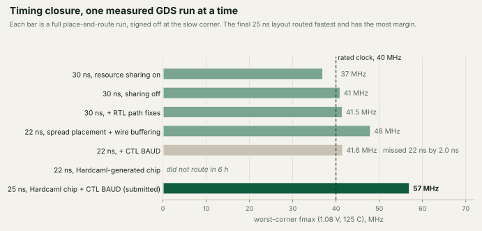
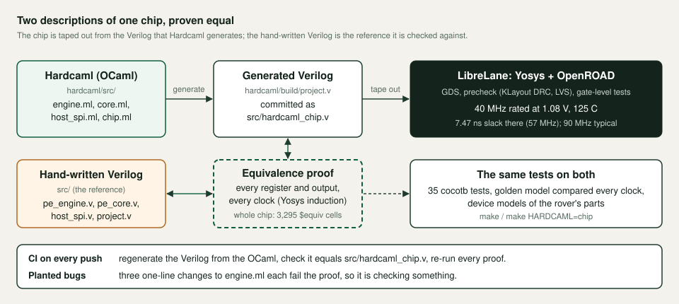

# Protocol Emulator: write-up

*Rajat Gupta, Year 2 Electrical Engineering, National University of Singapore. Tiny Tapeout, IHP 130 nm (SG13CMOS5L), 8x4 tiles.*

> Sections marked **[after the bench]** are filled in once the hardware demos are filmed.

## 1. Introduction

I am on the NUS Mars Rovers team, where I design the power distribution boards and work on the sensors and the motor CAN bus. While testing the drive train, I kept running into the same problem: one test needs a CAN bus to command the CubeMars motors, an I2C bus to read the power monitor and an SPI bus to sample the current sense, and every bus comes from a different chip or a different microcontroller peripheral, each with its own timing and quirks. If the three buses are not on one clock, it is also hard to line up what the motor was told with what the power board saw.

Jane Street's challenge asks for an open-source protocol emulator ASIC: a small chip with an instruction set built for reading pins, writing pins and counting cycles precisely enough that a real protocol can be written as software. This matched my problem exactly, so the question I set myself was:

**Can one small chip be programmed to speak protocols it was not designed for, including all three buses of my rover bench at the same time, while being verified well enough to tape out?**

What I built: a chip with three small engines that share a program memory. The engines know nothing about any protocol. They provide generic pieces (shift registers, FIFOs, a bit timer that locks onto bus edges, a bit stuffer, a CRC unit, a clocked serial shifter), and the protocol is a short program of 4 to 49 sixteen-bit words. One engine is a full CAN 2.0 node, the other two are an I2C master and an SPI master, and all three programs fit in the 64-word program memory together and run at once. In total I wrote 22 programs for it, most of them after the hardware was finished.

| At a glance | |
|---|---|
| Engines | 3, sharing a 64 x 16-bit program memory and a 32-bit cycle counter |
| Programs | 22, from WS2812 LEDs to CAN with arbitration and ARM Serial Wire Debug |
| Clock | rated 40 MHz, signed off at the slow corner (1.08 V, 125 C); the layout has slack up to 57 MHz there and 90 MHz at the typical corner |
| Area | 51% of the 8x4-tile core, 3,286 flip-flops |
| Written in | Verilog, then again in Hardcaml; the taped-out Verilog is generated from Hardcaml and formally proven equal to the hand-written version |
| Verified by | a golden model compared on every clock, protocol tests against device models, formal proofs, coverage, gate-level simulation |

## 2. Background

### What a wire protocol needs

Almost every wire protocol is built from the same few things: bits that leave and arrive at the right moments, shift registers that turn words into bits and back, and some framing around them (start and stop bits, bit stuffing, CRCs, acknowledgements). UART, for example, is a start bit, eight data bits and a stop bit at a fixed rate. CAN adds arbitration (two nodes can start sending at once, and the one sending a 0 wins), bit stuffing (after five equal bits the sender adds an opposite bit so the receivers can stay in sync) and a 15-bit CRC. Therefore, if a chip provides these pieces in a general form, each protocol only needs a small program to arrange them.

### What already exists

This idea is not new, and I based my design on what already works:

- **RP2040 / RP2350 PIO** (Raspberry Pi): small state machines with a nine-instruction ISA, used for VGA, WS2812 and extra UARTs. My instruction set is close to PIO on purpose, so the programming model is familiar.
- **TI PRU, NXP FlexIO, XMOS**: other small cores or blocks for timed pin control.

These are all built into larger proprietary chips. What mine adds is that it is a standalone open-source chip, and that it has the pieces PIO lacks for bus protocols: a bit timer that follows the other device's clock, a hardware bit stuffer, a CRC unit, bus monitoring for arbitration, and a shared timestamp counter. These are explained in section 3.

### The constraints

Tiny Tapeout gives each design a fixed area of tiles and a small number of pins. The 8x4 tile size is one of the largest available, but it still has to hold the engines, their FIFOs and the program memory, which is made of ordinary flip-flops (1,024 bits of it). There are 24 digital pins: 4 for the host SPI port, 1 for an interrupt, and 19 for protocols. The chip is built with the open-source flow (Yosys for synthesis, OpenROAD through LibreLane for place and route) in GitHub Actions, which stops any job after 6 hours. This limit ended up shaping a lot of my decisions (section 5).

## 3. Architecture


```
            host MCU (RP2350 / ESP32)
                 |  SPI: registers, program memory, FIFOs
        +--------+---------------------------------------------+
        |   program memory 64 x 16 (shared)       TIME (32-bit)|
        |      |            |            |                     |
        |  engine 0     engine 1     engine 2      4 events    |
        |  X Y OSR ISR  ...          ...                       |
        |  TX/RX FIFO   bit timer    serial unit               |
        |  CRC, stuffer, monitor                               |
        +------+----------------+-------------------+----------+
               | 14 outputs      | 13 inputs         | open-drain
               +-----------------+-------------------+
                  uio[7:0] (bidirectional), uo_out[7:2], ui_in[7:3]
```

A host microcontroller loads programs and moves data through an SPI port. Each engine runs one instruction per tick, from its own wrap range in the shared program memory. There are eight instructions (JMP, WAIT, IN, OUT, PUSH/PULL, MOV, SET, CTL); the full encoding is in [ISA.md](ISA.md).

The engines are deliberately protocol-agnostic. Every extra piece of hardware was added only because several protocols needed it:

| Piece | What it does | Used by |
|---|---|---|
| Bit timer with edge resync | Counts bit periods. Any bus edge restarts the count, so the timer follows the transmitter's clock instead of drifting | UART RX, CAN, Manchester, DMX |
| Two pacing points | A paced pin write waits for the next bit start; any other paced instruction waits for the sample point. This means one engine can drive a bit and read it back in the same bit time | CAN TX with arbitration, UART TX/RX, 1-Wire slots |
| Serial unit | `IN/OUT PINS, n` moves n bits through one pin, one per tick, with an optional generated clock (CPOL/CPHA), duplex sampling and clock stretching | SPI (all modes), I2C, CAN fields, UART bytes |
| Bit stuffer | Both-levels (CAN) or ones (USB) stuffing on transmit, destuffing on receive, including a stuff bit straight after a field | CAN, USB, HDLC-style |
| CRC unit | Any width from 1 to 32 bits, any polynomial, fed from the bits sent or received | CAN (CRC-15), 1-Wire (CRC-8), CRC-32 |
| Monitor mode | "Does the bus equal the last bit I sent?" as a jump condition, and no resync on my own dominant bits | CAN arbitration and bit errors |
| Shared TIME | Every engine can read the same 32-bit cycle counter | timestamped CAN frames; lining up the three buses |
| `OUT PC` | A computed jump: a word from the host names the routine to run | I2C steps (start, byte, stop), 1-Wire steps |
| `CTL BAUD` | An engine writes its own bit timer | auto-baud UART, changing rate mid-frame |

## 4. What one engine can be

| Program | Words | What it does |
|---|---|---|
| `can.pio` | 45 | CAN 2.0A/B node: receives and ACKs every good frame, transmits with arbitration and an ACK check, timestamps every start of frame |
| `can_fault.pio` | 49 | the CAN node plus fault injection (a frame sent with its CRC inverted), for device emulation |
| `i2c_master.pio` | 13 | START / repeated START / STOP, ACK/NACK, clock stretching |
| `spi_master.pio` | 6 | any mode, full duplex, any length |
| `uart_tx.pio` / `uart_rx.pio` | 6 / 10 | 8N1, receiver locked to every edge, framing errors flagged |
| `uart_autobaud.pio` | 37 | UART receiver that finds the sender's baud rate by itself |
| `brs_tx.pio` | 19 | two bit rates in one frame, switched at the sample point (the CAN FD bit-rate switch) |
| `ws2812.pio` | 6 | WS2812 / NeoPixel LED strips |
| `onewire.pio` | 21 | 1-Wire master (DS18B20 temperature sensor) |
| `manchester_tx.pio` / `manchester_rx.pio` | 12 / 12 | Manchester coding; the receiver recovers the clock from the data |
| `ir_tx.pio` / `ir_nec_rx.pio` | 7 / 14 | IR remote on a 38 kHz carrier; NEC receiver using the bit timer |
| `dmx_tx.pio` | 15 | DMX512 stage lighting: break, mark-after-break, 8N2 at 250 kbit/s |
| `rgb_pwm.pio` | 18 | three PWM channels (an RGB strip) from one engine |
| `spi_auto.pio` | 4 | compact SPI master using autopull/autopush |
| `crc32.pio` | 8 | CRC-32 (Ethernet, zip, PNG), bit-exact with zlib |
| `swd.pio` | 28 | ARM Serial Wire Debug host: reads a Cortex-M's debug port |
| `servo.pio` | 8 | servo / ESC pulses |
| `edge_capture.pio` / `pin_logger.pio` | 6 / 8 | edge timestamps and pin-change logs, for the tools below |

### Flexibility: protocols added after the hardware was finished

The judging puts flexibility first, so I tested it the honest way: after the RTL was finished, I kept writing programs for protocols I had not designed for, and only changed the hardware when a protocol could not be done at all. Each of these needed something different:

- **WS2812** needs pulse-width coding: a 0 and a 1 are both a high pulse, just of different lengths.
- **1-Wire** has the master and the device sharing one open-drain wire in time slots.
- **Manchester** carries the clock inside the data, so the receiver waits 3/4 of a bit after each mid-bit edge and never mistakes an edge between bits for data.
- **IR** needs a 38 kHz carrier switched on and off by marks and spaces; the NEC protocol itself is left to the host.
- **SWD** uses one data wire that changes direction twice inside every transaction. With it, the chip can read and write an ARM microcontroller's debug port.
- **DMX512** is the UART program plus a timed break.
- **RGB PWM** drives three channels from one engine with no counters.

All of these pass against models in `test/test_more.py`.

Only one protocol idea needed new hardware: a receiver that does not know the baud rate in advance. I added one instruction, `CTL BAUD`, which lets an engine write its own bit timer (period and sample point from X). With it, `uart_autobaud.pio` times the sender's 'U' character with a 2-clock counting loop, divides the count by shifting, writes the bit timer and then receives normally. It receives at 10, 37 and 113 clocks per bit with nothing configured except the pins. The same instruction lets a program change rate in the middle of a frame, which is what CAN FD does: `brs_tx.pio` sends 16 bits at the nominal rate, switches at the sample point of the last one (CAN FD's BRS bit), sends 32 bits at the data rate and switches back. The test records the pin on every clock and matches the expected waveform exactly, at 40 -> 10 and 24 -> 4 clocks per bit. This shows the switching mechanism; a full CAN FD node (CRC-17/21, fixed stuff bits, 64-byte frames) would be a longer program. It cost 0.13% of the area; its timing cost is explained in section 5.

The chip can also *recognise* protocols. `edge_capture.pio` timestamps a pin's edges, and the host's classifier names UART (and its baud rate), CAN, NEC IR, DMX512, WS2812, Manchester, SPI/I2C clocks or PWM from the timing alone.

## 5. Building it

### Fitting 8x4

My first complete design (4 engines, with configuration and program memory readable by the host) placed at 74.5% utilisation, which was too dense to route. I measured what each block cost and cut in this order:

| Change | Effect |
|---|---|
| Configuration and program memory made write-only (the host keeps its own copy) | their read multiplexers were about 15% of the chip |
| 3 engines instead of 4 | CAN now fits in one engine, so the bench still needs only three |
| 16-bit instructions (3-bit delay field) | 11% less program memory and read logic |
| IN and MOV share one source multiplexer | about 5,000 um^2 per engine |
| The serial unit added back (+5%) | it made every program 2-4x shorter, which is what lets the bench fit in 64 words |

The result is 51% utilisation of the 1.21 mm^2 core.

### Timing closure

I signed off at the slow corner (1.08 V, 125 C), because that is where the chip is slowest and a rating below it would not be honest. My early runs at 50-60 MHz failed there, so I dropped the clock to 33 MHz and then bought speed back one measured step at a time:

| Run (all corners pass setup and hold unless noted) | Slow-corner slack | Worst-corner fmax | Slew / cap violations | Flow time |
|---|---|---|---|---|
| 30 ns, resource sharing on | 2.93 ns | 37 MHz | 508 / 150 | 5h20m |
| 30 ns, sharing off | 5.62 ns | 41 MHz | 201 / 72 | 5h04m |
| 30 ns, sharing off + two RTL path fixes | 5.92 ns | 41.5 MHz | 266 / 74 | 4h10m |
| 22 ns, spread placement, long-wire buffering | 1.26 ns | 48 MHz | 43 / 3 | 4h24m |
| 22 ns, the same plus `CTL BAUD` | -2.01 ns (failed) | 41.6 MHz | 15 / 0 | 4h30m |
| 22 ns, the Hardcaml-generated chip | did not route in 6 h | | | |
| **25 ns, the Hardcaml-generated chip with `CTL BAUD` (submitted)** | **7.47 ns** | **57 MHz** | **35 / 0** | **2h17m** |
| Typical corner, submitted design | 13.87 ns | 90 MHz | | |



What I learned at each step:

- **Resource sharing.** Yosys merged the three engines' shifters into shared multiplexer "supercells" and put one after the execute signal. The critical path was 86 logic levels; without sharing it is 59, for about 12% more cells. I turned sharing off.
- **RTL path fixes, tried and backed out.** I rewrote two paths so that the stuff-bit decision and the bit counts no longer waited on the full shifter and the opcode decode, and proved each rewrite changed no register or output (`formal/equiv.sh`). Before layout the worst path went from 19.3 to 15.8 ns, but after routing it gained only 0.3 ns, because the real path was dominated by wires, not logic. Worse, at 22 ns the layout with them overloaded Metal3 (117% of capacity) and detailed routing could not finish within 6 hours. I backed them out; they stay in the history, proven.
- **Wires were the real problem.** The timing report showed a small AOI gate driving 373 fF through a routing detour (7.2 ns slew, 5.2 ns on one gate, a quarter of the path). Spreading the placement to just above the utilisation and letting the resizer buffer any wire over 400 um removed most slew and capacitance violations and an hour of routing.
- **A tight target, then a looser one.** At 22 ns the resizer upsizes the critical gates, which helped, but it also packs the critical cells together. This chip is right at the limit of its busiest routing layer (Metal3, about 96% used), so adding `CTL BAUD` (0.13% of the area) tipped the layout into detours and cost 2 ns. At 25 ns the placement relaxed, Metal3 dropped to 91%, detailed routing finished in about an hour, and the shorter wires made the real worst path 17.5 ns: faster than any 22 ns run. Therefore I rated the chip at 40 MHz (the speed it was signed off at), with measured slack up to 57 MHz.

Because a GDS run took 4 to 6 hours, I also wrote `tools/sta_lite.sh`, a pre-layout timing estimate. It synthesises with LibreLane's own ABC script, reads the IHP Liberty tables and names the critical path in about three minutes, so I could rank RTL ideas before spending a GDS run on them.

Signing off at the slow corner costs nothing in function: every protocol's timing is a configuration value, and CAN at 1 Mbit/s still gets 40 clocks per bit at 40 MHz.

### Hardcaml



After the chip was working and verified in Verilog, I rewrote it in [Hardcaml](https://github.com/janestreet/hardcaml), the OCaml library Jane Street uses to generate its own FPGA and ASIC designs (`hardcaml/`). I did it one module at a time, and proved each Hardcaml module equal to its Verilog original before starting the next (section 6 has the proofs).

Writing it in Hardcaml changed a few things:

- The three engines are a loop over one `Engine.create` function instead of a Verilog `generate` block, and the program memory is a list of 64 registers.
- Bit widths are checked when the circuit is built, so a width mistake is an error instead of a lint warning.
- The tests and the equivalence proofs run against the generated Verilog, so the same verification covers both versions.

The chip is **taped out from the Hardcaml-generated Verilog** (`src/hardcaml_chip.v`), with the hand-written Verilog in `src/` kept as the reference it is proven against.

Getting there was a physical problem, not a logical one. Hardcaml's `mux` on a long list becomes a decoded AND-OR, which for the program-memory read means 64 one-hot select lines across the whole memory, three times. That netlist overloaded Metal3 (99.6%) and could not route in 6 hours. I rewrote the large multiplexers as trees of 2:1 muxes, which matched the hand-written netlist's cell mix closely, yet at 22 ns it routed even worse (110.6%). At 25 ns it routed in about an hour. This taught me that two netlists proven logically identical can route very differently, and that on a chip this full, the placement target matters as much as the logic.

## 6. Verification

Because I cannot fix silicon after tapeout, I checked the chip in layers, where each layer catches a different kind of mistake. The full details and the list of bugs each layer found are in [VERIFICATION.md](VERIFICATION.md); everything runs in CI on every push.

| Layer | What it checks |
|---|---|
| Golden model | `docs/ISA.md` was written first, and `sw/pemu/model.py` implements it in Python, cycle by cycle |
| Differential fuzzing | the RTL is compared with the model on **every clock**, under random programs, configurations, pin activity and host traffic: 18 internal registers per engine, every output and every bus read |
| Protocols vs device models | every program against cycle-level models of the real parts: INA228, MCP3208, DS18B20, WS2812, an ARM SW-DP, CubeMars motors, a bit-level CAN bus with arbitration, and zlib for CRC-32 |
| Formal proofs | the FIFO behaves exactly like an ideal queue for every input sequence (k-induction); for every program, a pin only changes when an engine whose own windows include it writes it, so engines cannot disturb each other |
| Equivalence | each Hardcaml module, and the whole chip, proven equal to the hand-written Verilog: every register and output bit on every clock (whole chip: 3,295 `$equiv` cells) |
| Coverage | 99.0% of all bits toggle both ways over the test suite; the engine logic 2,034 of 2,035 bits |
| Gate level | the same chip-level tests on the synthesised netlist |

To check that the proofs actually catch bugs, I planted deliberate bugs and confirmed that each one fails: five broken versions of the RTL for the property proofs, and three one-line bugs in the Hardcaml engine for the equivalence proof.

The layers found real bugs. For example, the fuzzer found that Icarus only re-evaluates a continuous assignment calling a function when the function's *arguments* change, so `MOV X, TIME` read a stale value in simulation but not in synthesis. The CAN tests found that a stuff bit is due straight after the last CRC bit when the CRC ends in five equal bits, which the receiver had read as the CRC delimiter. Coverage found three test gaps (the dividers' upper bits, CRC at 32 bits, host addresses above 0x3F).

## 7. Demos on hardware **[after the bench]**

Seven demos are planned in [DEMOS.md](DEMOS.md). Until the chip comes back from the fab, the LED board's FPGA plays the chip at 27 MHz from the same RTL.

**Remote-controlled room lights.** The LED board's IR receiver and RGB strip are wired to the FPGA playing the chip. Engine 0 decodes the light strip's own NEC remote and engine 1 runs the strip's PWM, so every button picks a colour. These are two protocols the chip was not designed for, against a device from another maker.

**Remote-controlled rover** (`test_bench.remote_rover_bench`). The same remote, decoded on one engine, becomes CubeMars CAN commands from a second engine, while the third samples motor current on the MCP3208: CAN 45 + IR 14 + SPI 4 = 63 of 64 words.

**Emulating the motor (hardware in the loop)** (`sw/motor_emu.py`). This is the reverse of the bench: the chip *is* an AK80-8 motor on the rover's CAN bus. It ACKs the controller's MIT-mode commands and answers with position, velocity and torque from a wheel model on the laptop, so the rover firmware can be tested with no motor. Faults can be switched on while it runs: replies with a corrupted CRC (sent by the chip at the bit level), late or dropped replies, a frozen encoder, over-temperature, or the motor dropping off the bus entirely. These are failures that are hard to cause with a real motor, and the controller has to survive them. **[what the controller did under each fault]**

### The rover drive-train bench

Setup: rover lifted so one wheel spins freely; AK80-8 motor on CAN at 1 Mbit/s (SN65HVD230 transceiver); INA228 on the PDB v1 feed (I2C); MCP3208 sampling the current sense (SPI); `sw/bench.py` runs a velocity ramp and logs everything.

**[Plots of commanded vs measured velocity, motor current vs PDB current, bus voltage sag during acceleration, all against the chip's timestamps; frame statistics; what the bench showed about PDB v1.]**

## 8. Evaluation

The question was whether one small chip can be programmed for protocols it was not designed for, including my rover bench's three buses at once, and be verified well enough to tape out. I think it was answered: 22 programs run on unchanged hardware (apart from one instruction added for auto-baud), the three bench programs run together in the 64-word memory, and the design passes every Tiny Tapeout check with 7.5 ns of slack at the slow corner. The part not answered yet is the silicon itself, which comes back after the March 2027 shuttle.

| Strength | Effect |
|---|---|
| Protocol-agnostic engines | new protocols were added as software after the hardware was frozen, which is the flexibility the challenge asks for |
| Golden model compared on every clock | any difference between the RTL and the specification shows up at the exact clock it happens, not as a vague test failure later |
| Device models of the real rover parts | the programs were tested against the parts they will actually drive, through the real SPI host port |
| Formal proofs with planted bugs | the proofs cover every input sequence, and the planted bugs show they are not passing trivially |
| Two descriptions proven equal | the taped-out Hardcaml version and the hand-written Verilog reference check each other |
| Signed off at the slow corner | the 40 MHz rating holds at 125 C and low voltage, not only at room temperature |

| Limitation | Improvement | Nature |
|---|---|---|
| 64 words of program memory; the bench uses 63 | an SRAM macro instead of flip-flops would give more words for the same area | design constraint |
| 4-word FIFOs, so the host must keep up with fast buses | deeper FIFOs, or DMA on the host side (the LED board's bridge already buffers in its FPGA) | design constraint |
| The busiest routing layer is about 91-96% full, so small changes can move timing by several ns | leave more area margin, or reduce the program-memory read wiring (three 64-to-1 read ports) | physical |
| GDS runs take 2-6 hours against a 6-hour CI limit | the faster 25 ns layout routes in about an hour; the pre-layout estimator ranks ideas first | tooling |
| Classical CAN only; DLC above 8 not handled | the CAN FD rate switch already works (`brs_tx.pio`); a full FD node needs the longer CRCs and frames in a new program | scope |
| SPI needs CLKDIV >= 1 (SCK up to clock / 8) because of the input synchronisers | a faster input path for one pin | design constraint |
| Not yet tested in silicon | the FPGA prototype runs the same RTL; silicon testing after the shuttle | not yet measured |

With more time, I would like to write programs for LIN, PS/2 and HDLC, run CAN FD using `CTL BAUD`, and measure how fast the chip really runs on silicon compared with the slow-corner prediction.

## 9. Reproduce

```
cd test && make                    # 35 cocotb tests on the hand-written Verilog
cd test && make HARDCAML=chip      # the same tests on the Hardcaml-generated chip
python -m pytest sw/test_tools.py  # assembler, CAN and motor helpers, virtual board
sh formal/run.sh                   # property proofs
sh formal/equiv_hc.sh project $(python3 formal/hc_names.py hardcaml/build/project.v)   # Hardcaml == Verilog
python sw/pe.py --sim can          # a demo on the golden model, no hardware
```

## References

1. Jane Street. *Protocol emulator ASIC competition.* blog.janestreet.com/protocol-emulator-asic-competition
2. Jane Street. *Hardcaml.* github.com/janestreet/hardcaml
3. Raspberry Pi Ltd. *RP2040 Datasheet*, chapter 3 (PIO).
4. Robert Bosch GmbH. *CAN Specification, Version 2.0*, 1991.
5. NXP Semiconductors. *UM10204: I2C-bus specification and user manual.*
6. Arm Ltd. *ARM Debug Interface Architecture Specification ADIv5* (Serial Wire Debug).
7. Tiny Tapeout. tinytapeout.com, and the IHP SG13 open PDK.
8. LibreLane / OpenROAD and Yosys: the open-source synthesis and place-and-route flow.
9. cocotb: Python verification framework.
